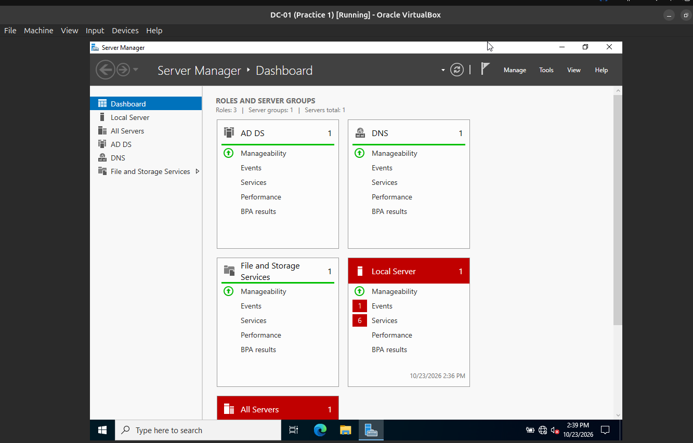
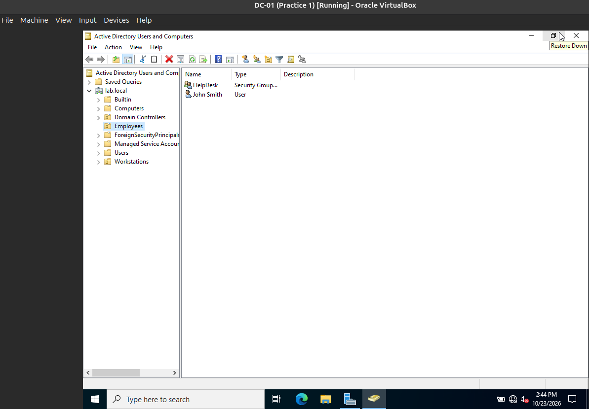
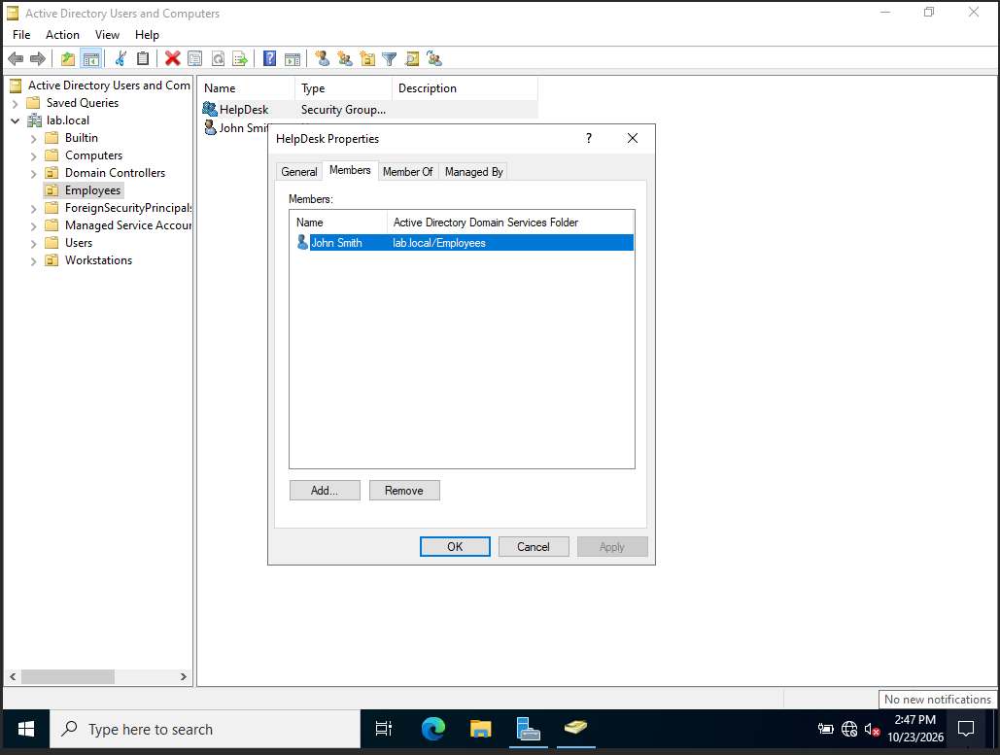
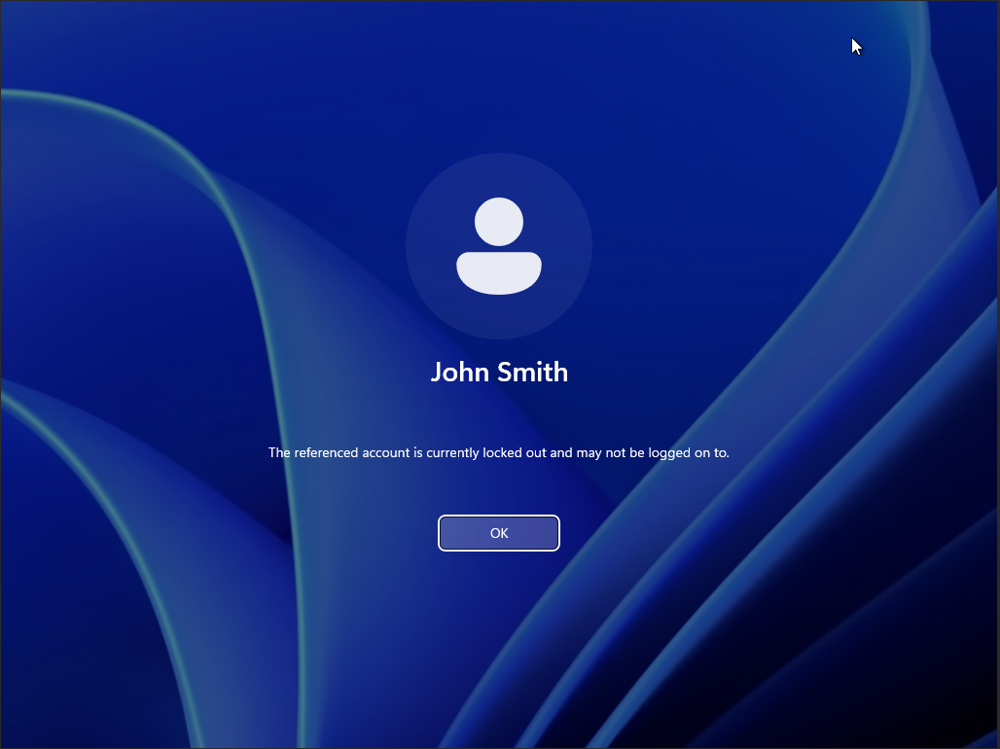
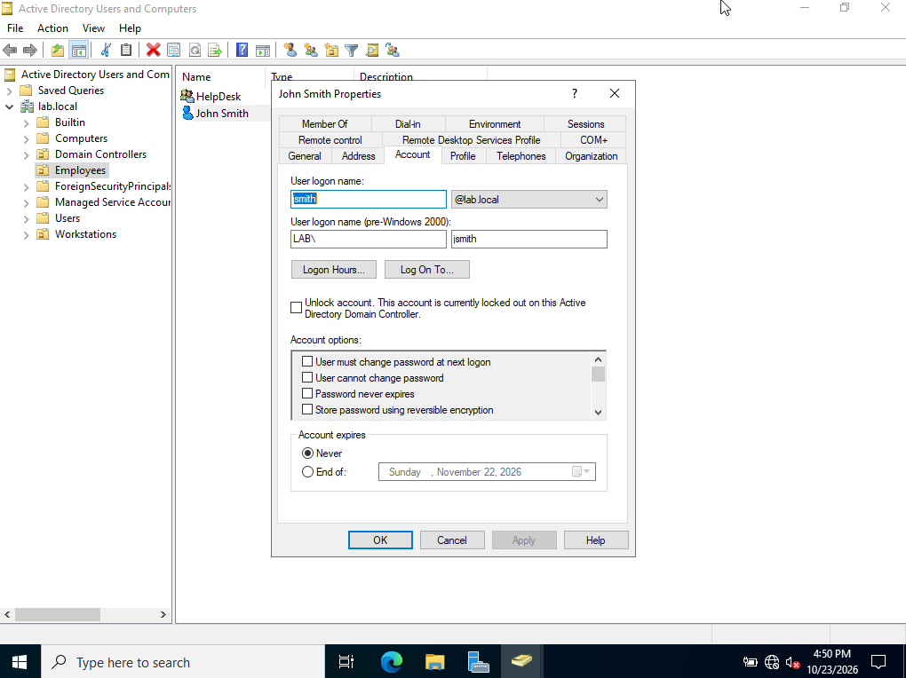
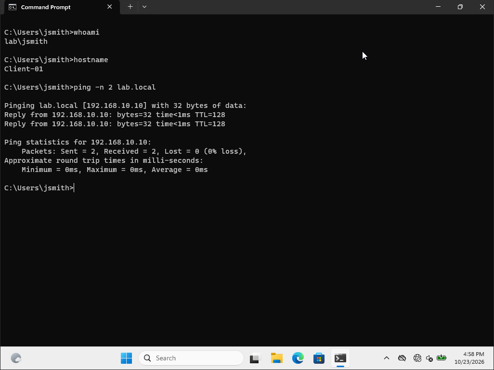
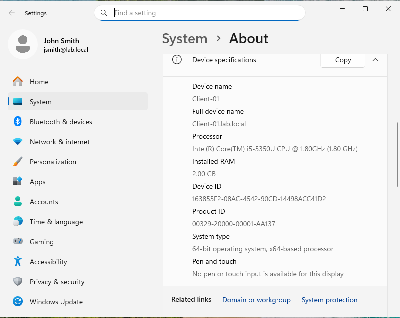
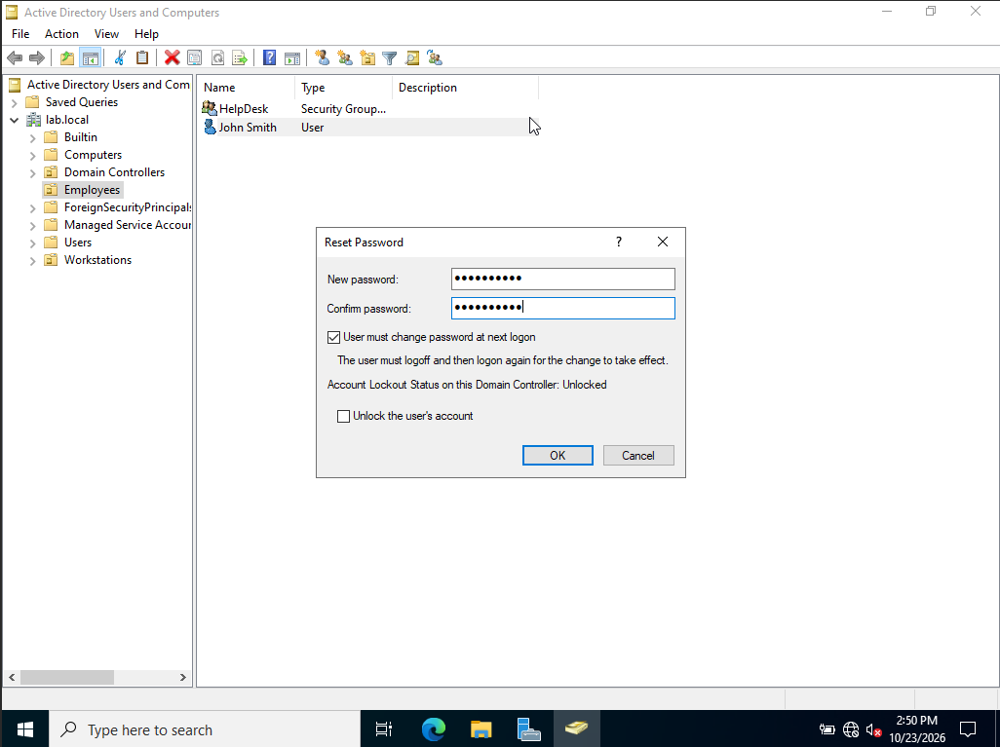
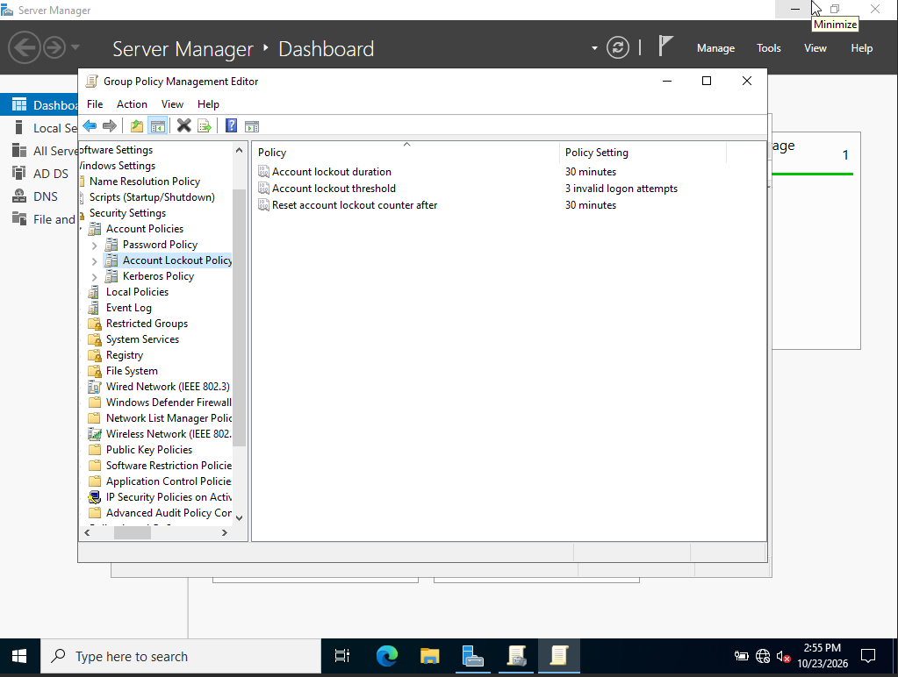

# Help Desk Active Directory Lab

A home lab I built to practice the Active Directory tasks help desk teams handle every day: password resets, account lockouts, and group management.

## Lab Environment

| Machine | Role | OS | IP |
|---|---|---|---|
| DC-01 | Domain controller, DNS | Windows Server 2022 | 192.168.10.10 |
| CLIENT-01 | Domain-joined workstation | Windows 11 Enterprise (evaluation) | 192.168.10.20 |

- Platform: Oracle VirtualBox
- Network: isolated internal network (`labnetwork`)
- Domain: `lab.local`

## What I Built

- Installed and configured Windows Server 2022
- Set a static IP and promoted the server to a domain controller (AD DS + DNS)
- Created an organizational unit, a test user, and a HelpDesk security group
- Built a Windows 11 client, configured its network and DNS, and joined it to the domain
- Verified domain sign-in with a standard user account

## Resolved Tickets

| Ticket | Summary |
|---|---|
| [Password reset](Tickets/01-password-reset.md) | Reset a user's password and troubleshot a rejected new password |
| [Account lockout](Tickets/02-account-lockout.md) | Configured a lockout policy, reproduced a lockout, and unlocked the account |

## Problems I Solved While Building It

- Fixed a VM that wouldn't boot because the wrong ISO was attached
- Bypassed the Windows 11 TPM/Secure Boot check for a virtual machine
- Fixed a missing network adapter by changing the virtual adapter type
- Resolved memory limits on an 8 GB laptop by running the VMs in separate sessions

## Skills Practiced

Active Directory Users and Computers · DNS · Group Policy · static IP configuration · domain join · user account management · troubleshooting · documentation

## Planned Next

- Group membership changes
- Group Policy objects (desktop restrictions)
- Pair with my [Jira ticketing lab](link-here)# Helpdesk-ad-lab
## Screenshots

**Domain controller roles (AD DS and DNS)**

**Organizational unit, user, and security group**

**HelpDesk group membership**

**Resetting a user's password**
**Account locked out on the client**

**Unlocking the account in Active Directory**

**Signed in as a domain user, DNS and connectivity working**

**Client joined to the lab.local domain**

**Account lockout policy (3 attempts)**

